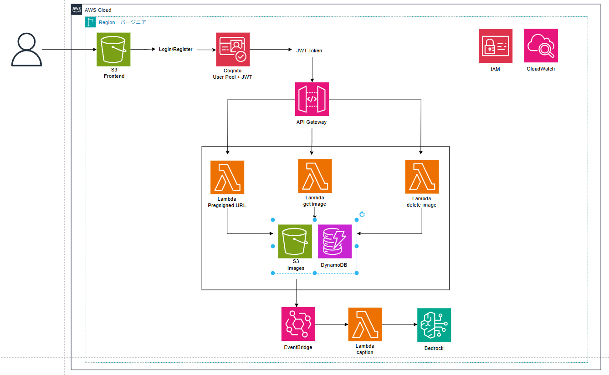
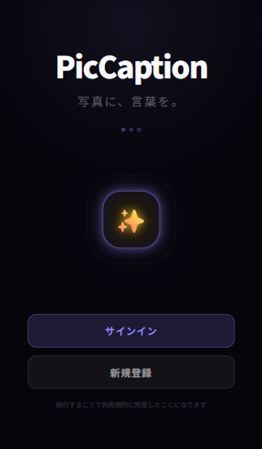

# PicCaption — 画像アップロードと AI キャプション生成アプリ

PicCaption は、画像をアップロードして Amazon Bedrock で説明文（キャプション）を生成し、ギャラリー形式で確認できる学習用アプリケーションです。

このプロジェクトでは AWS の各サービスを Terraform で構築し、画像のアップロードから保存、非同期処理、キャプション生成までを一連のイベント駆動型フローとして実装しています。学習用の実験プロジェクトとして、サーバーレス構成と AWS サービス連携を理解するための実装です。

## 主な機能

- Amazon Cognito によるユーザー登録・メール確認・ログイン
- API Gateway と Lambda による認証付き API
- S3 の Presigned URL を使った画像の直接アップロード
- DynamoDB への画像情報、処理状態、生成されたキャプションの保存
- S3 Event Notification と SQS を利用した非同期画像処理
- Amazon Bedrock による画像キャプション生成
- Amazon CloudFront（HTTPS）と非公開 S3 バケットによるフロントエンド配信

## 構成



## アプリケーション画面



## 技術スタック

| サービス | 用途 |
|---|---|
| Amazon S3 | 画像保存、静的フロントエンド配信、Lifecycle によるストレージクラス移行 |
| Amazon API Gateway | `/upload` と `/images` の REST API |
| AWS Lambda | Presigned URL 発行、画像一覧取得、キャプション生成 |
| Amazon SQS | 画像処理イベントのキューイング |
| Amazon DynamoDB | 画像メタデータ、ユーザー ID、処理状態、キャプションの保存 |
| Amazon Bedrock | 画像からのキャプション生成 |
| Amazon Cognito | ユーザー登録、メール確認、認証 |
| Amazon CloudFront | HTTPS によるフロントエンド配信。OAC 経由で非公開 S3 バケットへアクセス |
| AWS IAM | Lambda 実行ロールとサービス間のアクセス制御 |
| Amazon CloudWatch | Lambda ログとエラー監視 |
| Terraform | AWS インフラストラクチャのコード化 |
| Python 3.12 | Lambda 関数の実装 |

## ディレクトリ構成

```text
piccaption/
├── terraform/                  # AWS インフラストラクチャ
│   ├── apigateway.tf
│   ├── cognito.tf
│   ├── cloudwatch.tf
│   ├── cloudfront.tf
│   ├── dynamodb.tf
│   ├── iam.tf
│   ├── lambda.tf
│   ├── main.tf
│   ├── outputs.tf
│   ├── s3.tf
│   ├── sqs.tf
│   ├── variables.tf
│   └── ...
├── lambda/
│   ├── get_presigned_url/
│   │   └── handler.py
│   ├── get_images/
│   │   └── handler.py
│   └── caption_processor/
│       └── handler.py
├── frontend/
│   ├── index.html
│   ├── app.js
│   └── style.css
├── image/
│   └── architecture.png
├── deploy.sh
├── README.md
└── .gitignore
```

## 必要環境

- AWS アカウントと Terraform でリソースを作成できる権限
- Terraform（`terraform/main.tf` に定義されたバージョン制約を確認してください）
- AWS CLI と設定済みの AWS 認証情報
- Bash 環境（`deploy.sh` の実行用。Windows では Git Bash または WSL を推奨）
- 利用する Amazon Bedrock モデルへのアクセス許可

## セットアップ

### 1. Bedrock モデルのアクセス確認

AWS Console で対象の Amazon Bedrock モデルが利用可能であることを確認します。Terraform 変数 `bedrock_model_id` の既定値は `anthropic.claude-haiku-4-5` です。モデルへのアクセス可否はリージョンやアカウントによって異なるため、事前に確認してください。

### 2. AWS 認証情報を確認

AWS Academy Learner Lab などを利用する場合は、現在の認証情報が有効であることを確認します。

```bash
aws sts get-caller-identity
```

認証情報や秘密鍵を Git 管理下のファイルへ保存しないでください。

### 3. Terraform でインフラを構築

```bash
cd terraform
terraform init
terraform validate
terraform plan
terraform apply
```

`terraform apply` の前に、作成・変更されるリソースと利用料金を確認してください。主な出力値は次のコマンドで表示できます。

```bash
terraform output
```

### 4. フロントエンドを S3 にデプロイ

プロジェクトのルートディレクトリに戻り、デプロイスクリプトを実行します。

```bash
cd ..
bash deploy.sh
```

このスクリプトは Terraform の API Gateway URL と Cognito の設定値をフロントエンドへ反映し、`index.html` を非公開 S3 バケットへアップロードします。CloudFront のデプロイ完了後、出力された HTTPS URL をブラウザーで開いてください。CloudFront の初回作成には時間がかかる場合があります。

### 5. アプリケーションの動作確認

1. Cognito でユーザー登録を行います。
2. メールに届いた確認コードを入力してログインします。
3. JPG / PNG 形式の画像をアップロードします。
4. ギャラリーを再読み込みし、処理状態と生成されたキャプションを確認します。

## AWS リソースの削除

検証終了後、不要なリソースを削除してください。

```bash
cd terraform
terraform destroy
```

削除対象を確認してから実行してください。Learner Lab などの一時認証情報が失効した場合は、再度認証情報を設定する必要があります。

## セキュリティとコストに関する注意

- 画像バケットとフロントエンド用 S3 バケットはパブリックアクセスをブロックします。画像には期限付き Presigned URL を使い、フロントエンドは CloudFront OAC 経由で配信します。
- CloudFront の標準ドメインで HTTPS を提供し、HTTP リクエストは HTTPS へリダイレクトします。独自ドメインを使う場合は CloudFront 用 ACM 証明書（us-east-1）の追加設定が必要です。
- Terraform の state、AWS 認証情報、秘密情報、`terraform.tfvars` は Git 管理下に含めないでください。`.gitignore` は新規の untracked ファイルのみを対象にするため、追跡済みファイルから既存の秘密情報を除外する機能はありません。
- S3 Lifecycle、DynamoDB のオンデマンド課金、CloudWatch Logs の保持期間を設定していますが、S3、SQS、Lambda、Bedrock、その他の AWS サービスには利用料金が発生する場合があります。
- 料金と AWS 学習環境（例: Learner Lab）の利用制限を確認し、検証後は不要なリソースを削除してください。

## 現状の制約と改善点

- Presigned URL 発行 Lambda は受信したファイル名と Content-Type に依存しています。実運用では画像形式・サイズのサーバー側検証や、アップロード頻度の制限が必要です。
- Lambda のエラー応答やログに内部エラー情報が含まれる場合があります。利用者へ返すエラーと運用ログを分離し、秘密情報や個人情報を記録しないようにします。
- SQS の再試行、失敗メッセージの隔離、重複イベントへの対応を検証し、キャプション処理の信頼性を高めます。
- 画像処理のジョブイベントはリアルタイム性と信頼性のバランスを考慮し、将来的には Step Functions などとの連携も検討できます。

## まとめ

本プロジェクトは、AWS の基礎学習から応用までを段階的に体験できる構成を意図しています。画像アップロード、認証、非同期処理、AI 生成、S3 配信といった複数のサービス連携を一つのアプリとして実装することで、AWS の実務的な理解を深めることを目的としています。

このリポジトリをベースに、運用面の改善（HTTPS、Secrets Manager、監視強化、リトライ設計）を進めることで、より実践的なアプリケーションへ発展させることができます。
